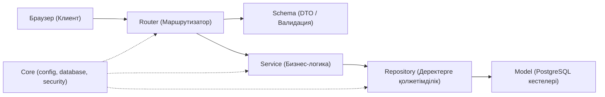

# Backend қабат картасы (4-сабақ)

**Жобам:** EduPlatform — мұғалімдерге тесттер мен тапсырмалар құруға, ал студенттерге онлайн тестілеуден өтіп, AI менторымен білім алуға арналған білім беру жүйесі.

---

## Қабат картасы

| Қабат | 1-әрекет: Мұғалім жаңа тест құрады | 2-әрекет: Студент тест жауаптарын тапсырады |
| :--- | :--- | :--- |
| **Router** | `POST /api/v1/tests/` · Мұғалім (teacher) | `POST /api/v1/tests/{id}/submit` · Студент (student) |
| **Schema** | `TestCreate` (сұрақтар, уақыт) → `TestResponse` (ID, автор) | `SubmitAnswers` (жауаптар тізімі) → `SubmissionResponse` (балл, нәтиже) |
| **Service** | Сұрақтар санын тексеру; таймерді оң мәнге валидациялау | Уақыт лимитін тексеру; баллдар мен дұрыс жауаптарды есептеу |
| **Repository** | `TestRepository.create_test_with_questions` | `TestRepository.save_submission_and_score` |
| **Model** | `tests`, `questions` кестелері | `test_submissions`, `users` кестелері |
| **Қате-HTTP** | Тақырып бос немесе автор табыл Handle → `400 Bad Request` | Уақыт бітіп кетті немесе тест жабық → `403 Forbidden` |

---

## Біздің ереже
- Router-де SQL жоқ, service-те HTTPException жоқ
- Құпиялар тек `.env`-те сақталады

